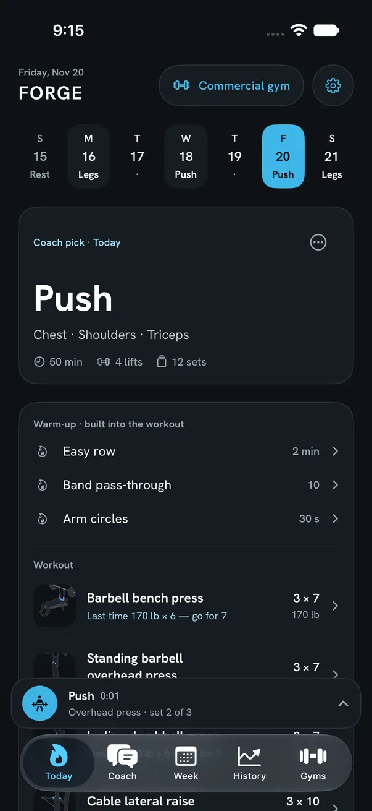
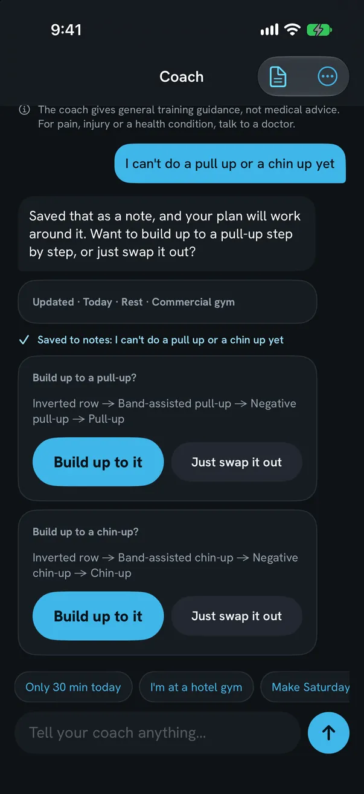
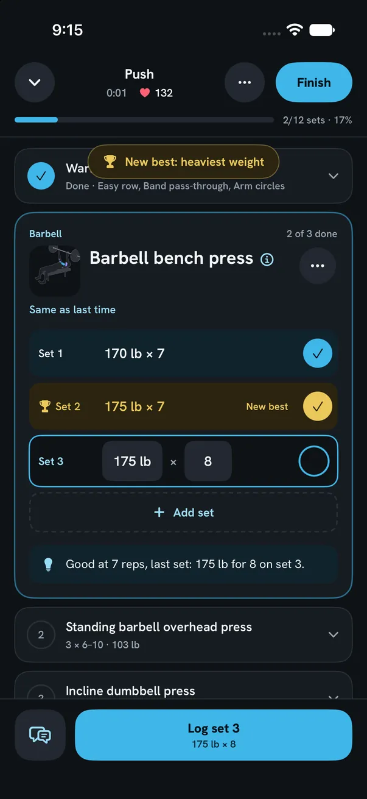
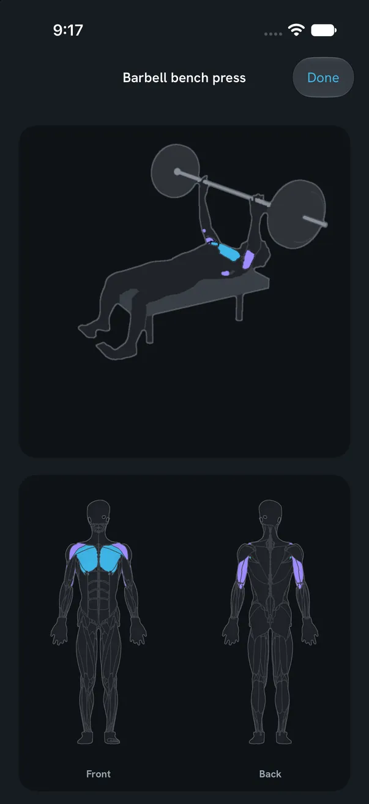
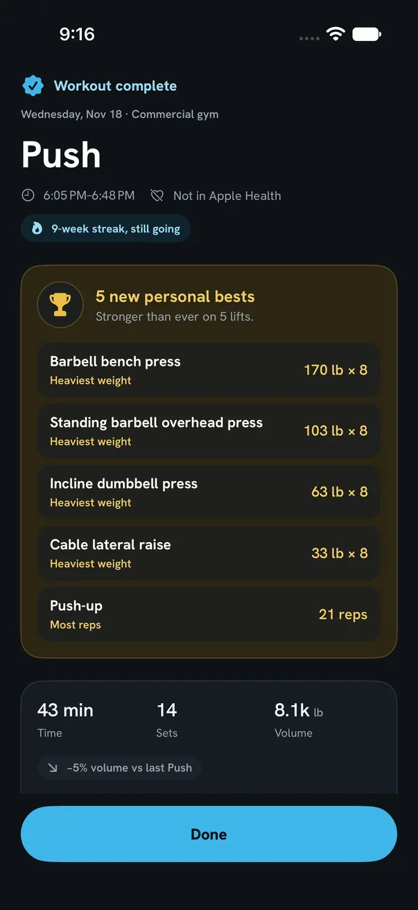

# FORGE

**An adaptive strength coach for iPhone and Apple Watch, powered by on-device AI.**

FORGE plans each session from your recovery, schedule, equipment and feedback, 
sets a weight target for every lift, and saves every workout to Apple Health.

**Status:** pre-alpha, in private TestFlight testing. Requires iOS 27 and watchOS 27.

[Website](https://tajshaik24.github.io/forge-app/) · [Support](support.md) · [Privacy policy](privacy.md) · [Report a problem](https://github.com/tajshaik24/forge-app/issues/new)

  
  
  
  
  

## Highlights

- **AI coach, on device.** Picks today's session from muscle readiness, your split and training days, using Apple Intelligence on your iPhone. A built-in coach takes over when Apple Intelligence is off.
- **Learns your limits.** Tell it about an injury or a lift you can't do yet, and it plans around it.
- **Equipment-aware.** Gym profiles for home, commercial and travel gyms. The coach only programs what that gym has.
- **Finds your weights.** No test sets: every set counts. A new lift starts from your other lifts for the same muscle, your first set fine-tunes it, and progressive overload moves it up from there.
- **167 animated exercises.** Every lift is a drawn figure moving through a rep, with the main muscles lit in ice blue and the helpers in violet.
- **Weekly volume.** Sets per muscle against a 10 to 20 set growth range.
- **Apple Health, Apple Watch and Live Activities.** Log sets on your wrist, see the rest timer on the Lock Screen, and find every workout in Fitness.
- **Friends.** Add friends with a link and keep a weekly streak together over iCloud sharing; friends only see check-ins.
- **Private by design.** No account, no server, no ads, no tracking.

## This repo

This is the public site for FORGE, served by GitHub Pages at <https://tajshaik24.github.io/forge-app/>. The app's source is private.

| Path | What it is |
|---|---|
| `index.html` | The marketing page. Plain HTML with no front matter, so Jekyll copies it as is. |
| `assets/site.css`, `assets/site.js` | Its styles and script (vanilla JS, no build step). |
| `assets/shots/`, `assets/watch/` | App screenshots from the simulator's demo data. |
| `assets/anim/`, `assets/muscles/` | Exercise animation strips (12 frames each) and muscle maps. |
| `assets/og.png` | The 1200 × 630 link preview card. |
| `privacy.md`, `support.md` | The pages App Store Connect links to, rendered through `_layouts/default.html`. |
| `invite.html` | The landing page for friend-invite links. |

To preview the marketing page, run `python3 -m http.server` here and open <http://localhost:8000/>. The Markdown pages need Jekyll (`bundle exec jekyll serve` with the `github-pages` gem) to render.
