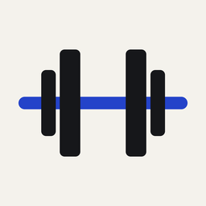
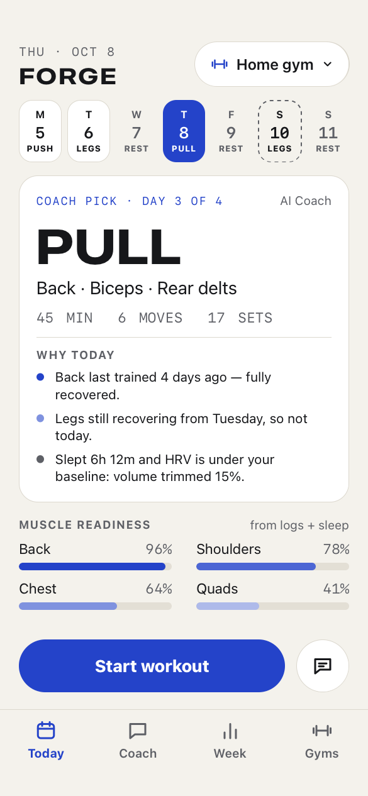
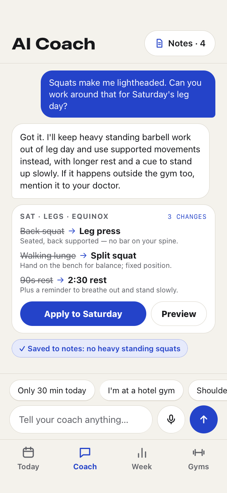
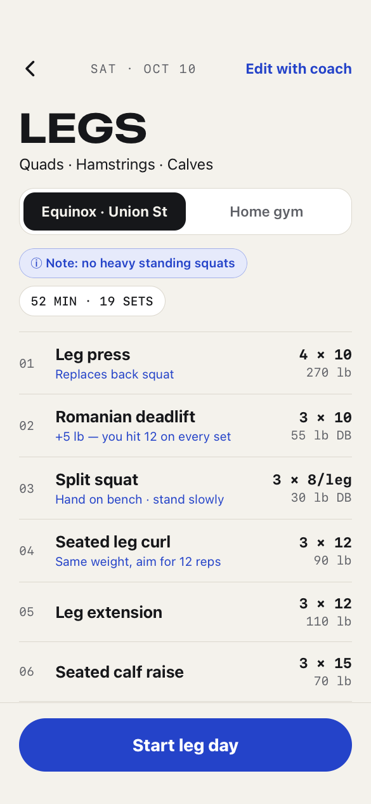
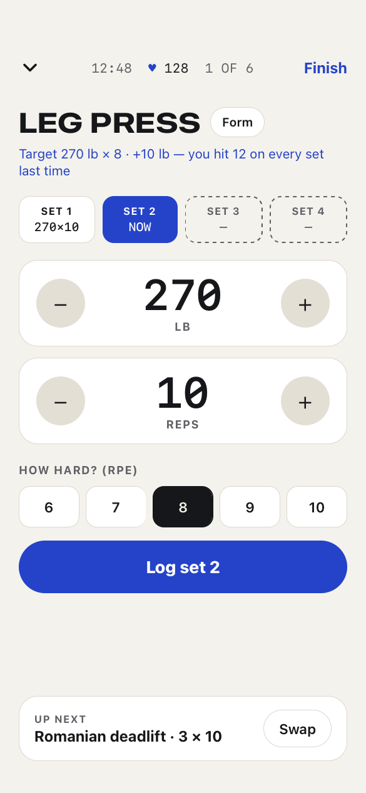
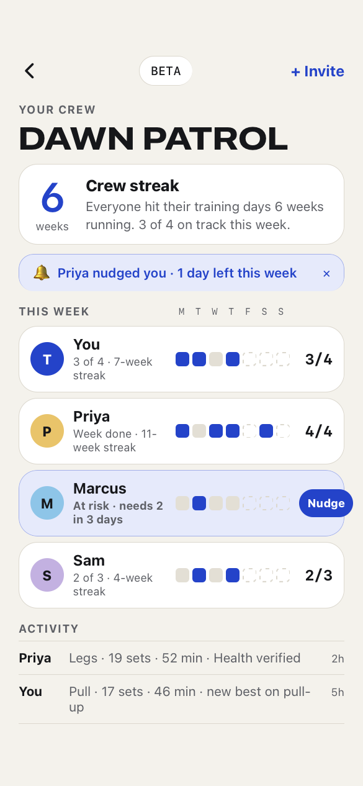
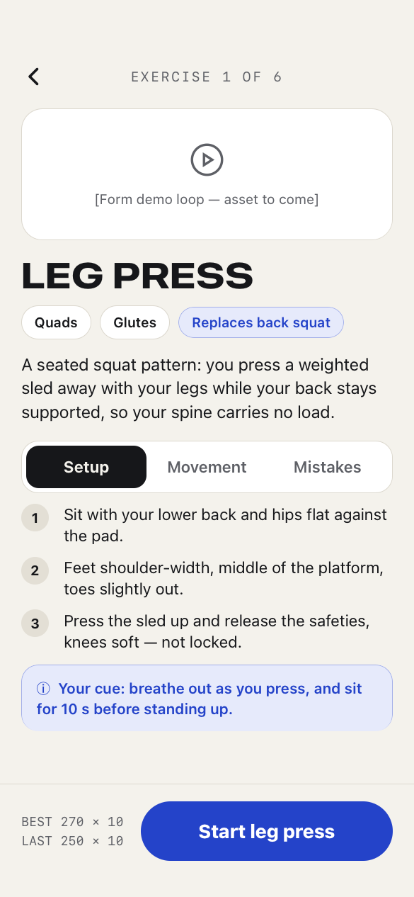
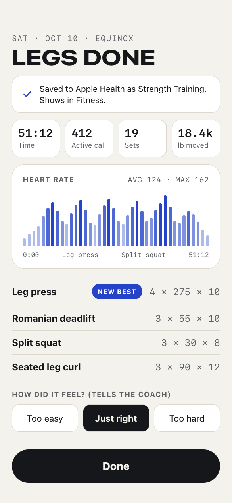
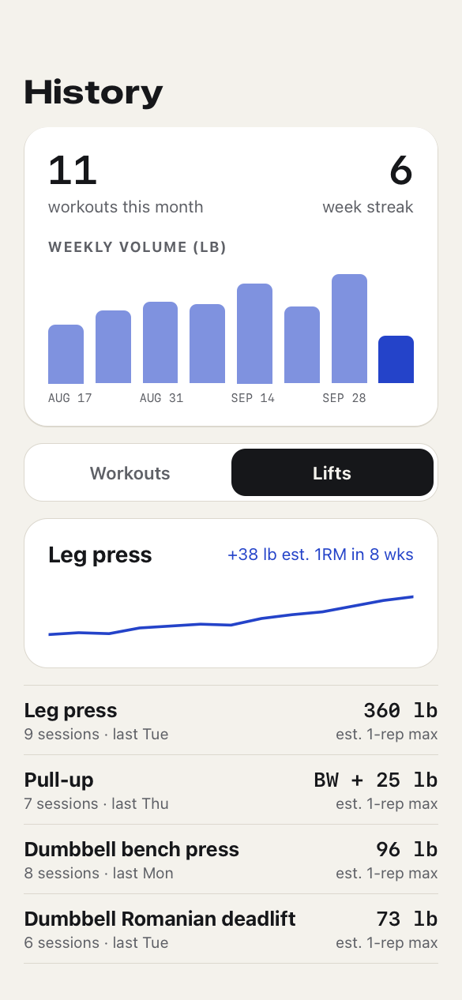
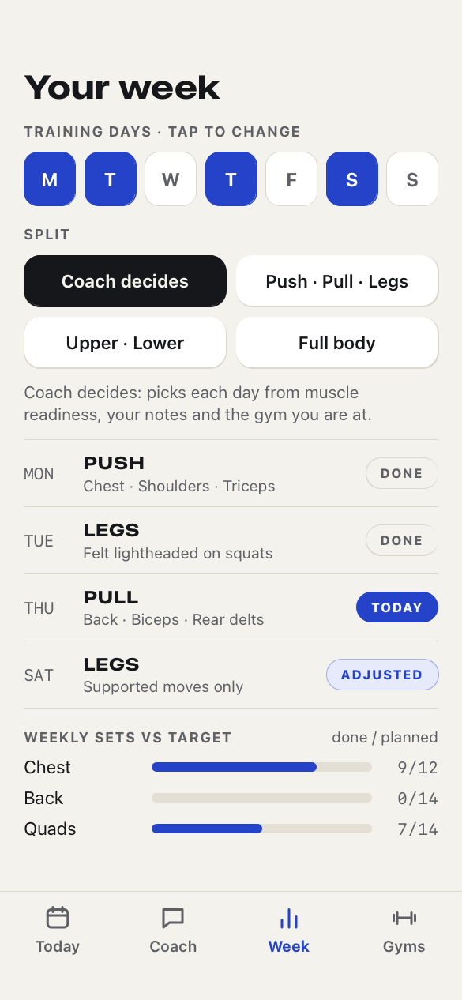

# FORGE

**An adaptive strength coach for iPhone and Apple Watch, powered by on-device AI.**

FORGE plans each session from your recovery, schedule, equipment and feedback, 
sets a weight target for every lift, and saves every workout to Apple Health.

**Status:** pre-alpha, in private TestFlight testing. Requires iOS 27 and watchOS 27.

[Support](support.md) · [Privacy policy](privacy.md) · [Report a problem](https://github.com/tajshaik24/forge-app/issues/new)

  
  
  
  
  

## Highlights

- **AI coach, on device.** Picks today's session from muscle readiness, your split and training days, using Apple Intelligence on your iPhone. A built-in coach takes over when Apple Intelligence is off.
- **Learns your limits.** Tell it about an injury or a lift you can't do yet, and it plans around it.
- **Equipment-aware.** Gym profiles for home, commercial and travel gyms. The coach only programs what that gym has.
- **Finds your weights.** Test sets find a starting weight for each lift, then progressive overload moves it up as you get stronger.
- **Plans the week.** Every training day gets a plan, and you can move, shorten or skip any of them.
- **Form guides** for every exercise, with a warm-up and cool-down built into each workout.
- **Apple Health, Apple Watch and Live Activities.** Log sets on your wrist, see the rest timer on the Lock Screen, and find every workout in Fitness.
- **Crews (beta).** Weekly streaks with friends over iCloud sharing.
- **Private by design.** No account, no server, no ads, no tracking.

  
  
  
  

Design mockups. The app follows the same layout in light and dark mode.

